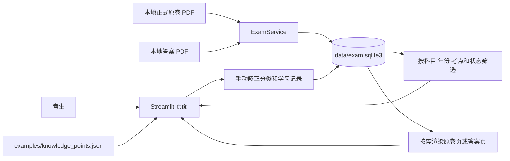

# 真题学习台架构

## 数据流

1. `app.py` 创建以数据目录为键缓存的 `ExamService`。服务把原卷 PDF、解析出的题目、分类和学习记录写入独立的 `exam.sqlite3`；原始 PDF 字节保留在本机。答案 PDF 挂接在对应原卷记录上。
2. 页面使用主科目、年份、考点、练习状态、错题、待复核和文本查询筛选题目。主科目由题号规则建议，考点由关键词辅助建议；建议可待复核，筛选题目不改变原卷文件。每题记录原卷页码范围和是否含图表等视觉内容。
3. 选中题目后，可展开原卷页预览，`render_page` 按需返回可导入原卷或答案 PDF 的页面图像。全扫描原卷因无可提取文字，目前无法导入拆题；扫描答案 PDF 可按页查看。学生自行完成题目，再手动查看已有答案 PDF 的页码。答案页码不假定与原卷页码一致；系统不自动判卷或生成参考答案。
4. `save_progress` 保存学生自评的未练、需复习或“本题已理解”状态、错题标记和笔记；`set_classification` 保存学生手动修正的科目和考点。薄弱统计优先列出未解决错题，再列需复习和未练题量。这些只是本地练习记录，不是客观掌握率或考试预测。
5. `examples/knowledge_points.json` 提供四科知识卡。学生先做题、记录错因，再重建该考点的原理解释并写出一个改变题设条件后的推导或结论。`get_topic_progress` / `save_topic_progress` 按考点保存这两段学习记录，避免每道题重复填写；“我已自行核对”只记录学生自评，不自动验证内容。
6. “优先复习考点”只对当前可见的原卷范围汇总，把未解决错题排在前面，并显示是否已有原理/迁移记录；当前可见范围由回忆版开关决定，而不是年份筛选。如果完全没有练习记录，会说明暂按未练题量排列，不能将其视为诊断结果。题目复习状态与知识点反思记录分别存储；本题自评为“本题已理解”不能推导出客观知识掌握率。之后可点选另一年份未练的同考点题直接切换，检验是否能迁移到不同条件。

## 来源和分类边界

正式原卷与 2026 回忆版使用不同 `source_kind`。回忆版默认从练习列表排除；明确勾选后仍有醒目说明，因为部分文本混有解析、缺字或只在扫描页呈现。主科目建议依据题号规则，考点建议依据关键词匹配；学生可以手动更正并复核待分类题目。知识卡目录更新时，可在折叠的维护区刷新自动建议，手动修正和学习记录会保留。这些建议不代表自动分类准确率。题库频次只描述当前可见的本地文件和练习记录，不能预测考试重点。

本页面不加载 BGE 或 Ollama。仓库中的旧 RAG 核心代码留作后续可选方向，不参与当前做题、答案核对或薄弱点统计。
