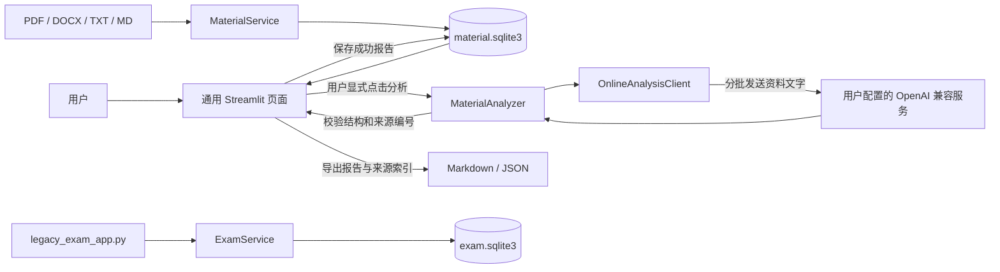

# 学习资料分析助手架构

## 通用资料流

1. `app.py` 按 `CSA_DATA_DIR` 创建 `MaterialService`。它将原始上传文件、提取文字、来源片段和每份资料自己的分析报告写入 `material.sqlite3`。导入按原始文件内容去重；一份资料的报告、来源和删除操作均限定在该资料 ID 下。
2. 文件提取支持可选文字 PDF、DOCX、TXT、MD。PDF 保留页码，DOCX/TXT/MD 保留段落定位。PDF 页面无可提取文字时显示警告；全扫描 PDF 和图像内容不做 OCR。用户可在页面展开 S 编号对应的原文。
3. 页面只在用户显式点击“生成分析报告”或“重新分析”后构造 `OnlineModelConfig` 并调用模型。服务对 OpenAI Chat Completions 兼容接口分批请求；整份可提取文字都会发送，资料较长时可能产生多次请求和费用。未完整配置时分析按钮禁用。
4. `MaterialAnalyzer` 校验模型返回结构，并要求提纲和知识点的来源编号来自真实输入片段。检查只确保引用 ID 有效，不能证明生成内容正确。请求出错时不会覆盖已有成功报告；异常展示使用安全文本，不输出可能包含请求头的底层追踪信息。
5. 页面和导出都呈现来源索引、模型和覆盖数量。Markdown 与 JSON 导出包含文档来源映射，不包含 API 密钥。AI 内容明确标记为需核对。

## 隐私和存储边界

API 密钥可由当前会话输入或 `CSA_ANALYSIS_API_KEY` 环境变量提供；不会进入 SQLite 分析报告或导出。服务地址和模型默认值可由 `CSA_ANALYSIS_BASE_URL`、`CSA_ANALYSIS_MODEL` 设置。上传材料及报告保存在本机 `material.sqlite3`，网络分析时资料文字发送到用户选择的服务提供方。

旧版 408 真题学习台完整保留在 `legacy_exam_app.py`，使用独立 `ExamService` 和 `exam.sqlite3`；`scripts/start_408.ps1` 在 8502 端口启动它。新通用资料页面由 `scripts/start.ps1` 在 8501 端口启动。两套数据库各自存取，不互相覆盖。
